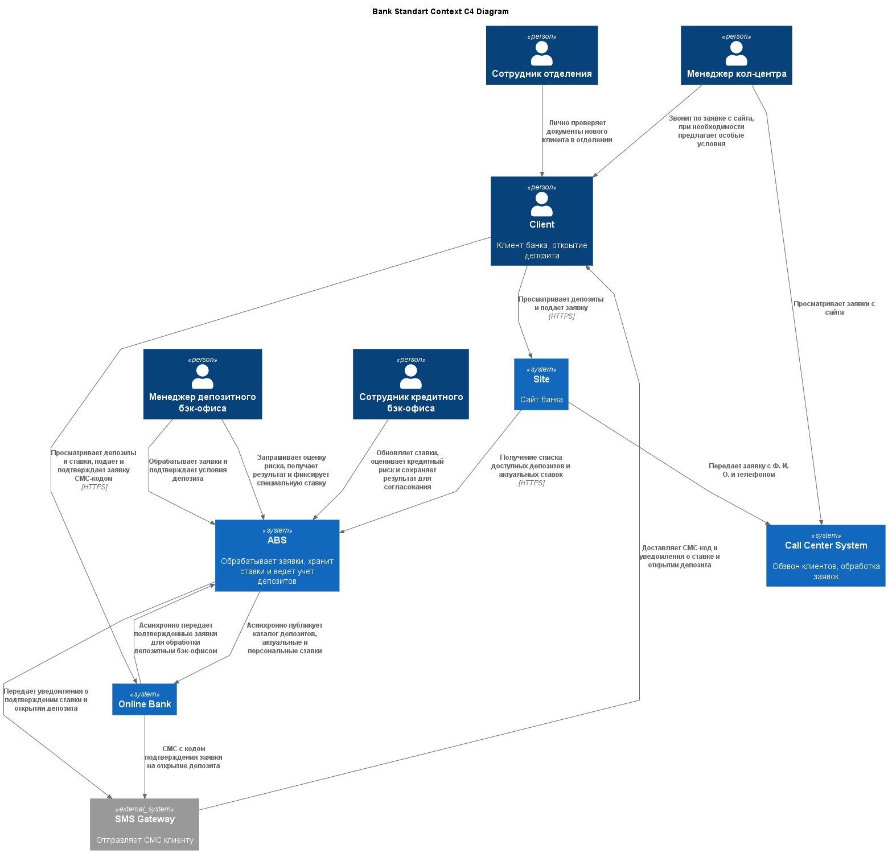
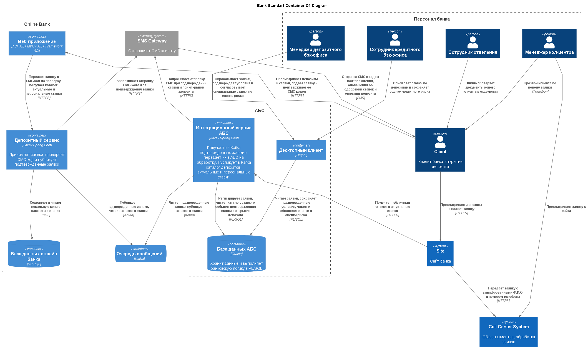

### **Название задачи: MVP открытия депозитов онлайн** 
### **Автор: Федоров Д.А.**
### **Дата: 22.11.2026**
### **Функциональные требования**
Опишите здесь верхнеуровневые Use Cases. Их нужно оформить в виде таблицы с пошаговым описанием:

|**№**|**Действующие лица или системы**|**Use Case**|**Описание**|
| :-: | :- | :- | :- |
|UC1|Клиент, сайт банка, АБС|Показ доступных депозитов с актуальными ставками на сайте|1. Клиент заходит в раздел доступных депозитов на сайт банка 2. Сайт получает список доступных депозитов и актуальные ставки 3. Клиент видит доступные депозиты с актуальными ставками|
|UC2|Клиент, сайт банка, система кол-центра, менеджер кол-центра|Подача заявки на депозит на сайте|1. Клиент вводит свое ФИО и номер телефона 2. Клиент отправляет заявку на депозит на сайте 3. Заявка отражается в системе кол-центра 4. Менеджер просматривает заявку, звонит клиенту и при необходимости предлагает особые условия|
|UC3|Новый клиент, сотрудник отделения | Личная идентификация нового клиента в отделении банка|**Предусловие:** менеджер кол-центра позвонил новому клиенту по заявке с сайта и сообщил о необходимости посетить отделение. 1. Клиент приходит в отделение и предъявляет документы. 2. Сотрудник отделения лично проверяет документы и удостоверяет личность клиента. 3. После успешной идентификации можно продолжить оформление депозита.|
|UC4|Клиент, интернет-банк, смс-шлюз|Подача заявки на открытие депозита в интернет-банке|1. Клиент находится в личном кабинете интернет-банка 2. Клиент вводит сумму депозита, указывает счет и подает заявку на открытие депозита 3. Клиенту приходит смс с кодом для подтверждения операции 4. Клиент вводит код подтверждения 5. Интернет-банк проверяет код 6. После успешной проверки заявка поступает на обработку в депозитный бэк-офис|
|UC5|Клиент, менеджер депозитного бэк-офиса, АБС, СМС-шлюз|Обработка заявки и подтверждение депозита|1. **Предусловие** заявка подтверждена СМС-кодом и поступила в депозитный бэк-офис (UC 4). 1. менеджер депозитного бэк-офиса обрабатывает и подтверждает условия депозита в АБС 2.Клиент получает СМС с подтверждением ставки 3. Депозит открывается в АБС 4. Клиент получает еще одно СМС после открытия депозита|
|UC6|Клиент, интернет-банк|Просмотр депозитов и персональных ставок в интернет-банке|1. Клиент находится в личном кабинете интернет-банка и открывает раздел "Депозиты" 2. Система интернет-банка получает список доступных депозитов, а также список депозитов с персонализированными условиями для конкретного клиента 3. Клиент видит доступные депозиты с актуальными ставками и персонализированные предложения|
|UC7|Сотдрудник кредитного бэк-офиса, сотрудник депозитного бэк-офиса, АБС|Ведение и обновление ставок по депозитам|1.Сотрудник кредитного бэк-офиса рассчитывает и обновляет ежедневные ставки по депозитам и сохраняет их в АБС 2. Менеджер депозитного бэк-офиса просматривает актуальные ставки в АБС и использует их при обработке заявок|
|UC8|Менеджер депозитного бэк-офиса, сотрудник кредитного бэк-офиса, АБС|Согласование специальной ставки по депозиту *Пункт, предложенный нейронкой*|**Предусловие:** при обработке заявки (UC 5) менеджер определил, что клиенту можно предложить специальную ставку. 1. Менеджер депозитного бэк-офиса запрашивает у сотрудника кредитного бэк-офиса оценку кредитного риска по клиенту. 2. Сотрудник кредитного бэк-офиса анализирует риск в АБС и передает результат менеджеру. 3. Менеджер рассчитывает специальную ставку по полученным данным и фиксирует ее в АБС. **Результат:** специальная ставка доступна для подтверждения условий депозита в UC 5.|
|||||
### **Нефункциональные требования**
Опишите здесь нефункциональные требования и архитектурно значимые требования.

|**№**|**Требование**|
| :-: | :- |
|1| Время работы 24/7|
|2| Высокая доступность, время недоступности не более 45 минут в месяц|
|3| При отказе основного ЦОД интернет-банк должен переключаться на резервный и выдерживать расчетную нагрузку. Время переключения не более 10 минут|
|4| Отклик по операциям не более 500мс - проектное допущение. Доставка СМС и ручная обработка заявки измеряются отдельно.|
|5| Возможнность горизонтального масштабирования, распределение запросов между экземплярами сервисов, серверами и ЦОД|
|6| Существующий стек баз данных банка MS SQL и Oracle|
|7| Лучше избежать прямой работы интернет-банка с API АБС при новом депозитном процессе|
|8| АБС может масштабироваться только вертикально из-за ограничения существующей системы|
|||
### **Решение**
Приведите диаграммы контекста и контейнеров в модели C4. Опишите там основные компоненты и интеграции всех элементов решения. 

[Исходник PlantUML](diagrams/c4_context.puml)

[Исходник PlantUML](diagrams/c4_container.puml)

* Была принято решение использовать Kafka, т.к. база данных АБС уже перегружена и лучше избегать прямой работы интернет-банка с API АБС, а также предпочтение использовать kafka на перспективу.
* Принято решение реализовать интеграционный сервис в АБС, который читает подтвержденные заявки из Kafka и регистрирует их через процедуры PL/SQL. Он публикует каталог и ставки в Kafka, предоставляет сайту публичный каталог по HTTPS и инициирует два СМС-уведомления по событиям АБС.
* Kafka позволяет буферизовать подтвержденные заявки, а интеграционный сервис может ограничивать скорость их обработки. Просмотры каталога в интернет-банке обслуживаются из копии в MS SQL. Эти два механизма защищают Oracle от всплесков нагрузки.
* Для депозитного сервиса и интеграционного сервиса АБС выбраны Java и Spring Boot. У части команды АБС есть опыт Java. Наличие экспертизы Spring Boot для разработки и сопровождения обоих сервисов нужно подтвердить. Веб-приложение на ASP.NET MVC обращается к депозитному сервису по HTTPS. Подключение к Kafka реализуют два новых сервиса, поэтому обновление платформы интернет-банка для этого обмена не требуется.
* Предлагается поручить внутренней команде интернет-банка доработку веб-приложения и разработку депозитного сервиса, включая проверку СМС-кода без доработки ядра подрядчиком. Команда АБС дорабатывает Delphi-клиент и процедуры Oracle PL/SQL и разрабатывает интеграционный сервис АБС. Команда сопровождения сайта дорабатывает форму и отправку заявок, а подрядчик системы кол-центра обеспечивает их прием и отображение. Ответственного за развертывание и эксплуатацию Kafka нужно согласовать.
* Сайт передает контактные данные в кол-центр для звонка. Новый клиент проходит идентификацию в отделении. В интернет-банке депозитный сервис проверяет СМС-код и только после этого публикует заявку. Бэк-офис обрабатывает ее в АБС, а клиент получает отдельные СМС после подтверждения ставки и после открытия депозита.
* После проверки СМС-кода и перед ответом об успешном подтверждении депозитный сервис одной транзакцией сохраняет в MS SQL подтвержденную заявку и запись для ее публикации. Фоновый обработчик публикует запись в Kafka и при сбое повторяет отправку. Интеграционный сервис АБС использует уникальный идентификатор заявки при регистрации в Oracle, чтобы повторно доставленное сообщение не создало вторую заявку.
* АБС - источник истины для каталога и ставок. MS SQL хранит локальную копию каталога и ставок, а также состояние заявок и записи для публикации. Сайт получает только публичные ставки. **Открытый вопрос: допустимая задержка обновления копии.**
* Кредитный бэк-офис сохраняет результат оценки риска, депозитный получает доступ к необходимому результату в рамках своих прав.
* Веб-приложение и депозитный сервис масштабируются горизонтально за счет дополнительных экземпляров и распределения запросов между ними. Состояние заявки и подтверждения хранится в MS SQL, поэтому запросы клиента могут обслуживаться разными экземплярами. Интеграционный сервис АБС ограничивает скорость обработки сообщений из Kafka с учетом допустимой нагрузки на Oracle. АБС масштабируется вертикально.
* Сайт и интернет-банк используют HTTPS для защиты клиентских данных при передаче. Внутренние интеграции, включая обмен с Kafka, также используют шифрование трафика. Доступ к данным АБС разграничивается по ролям: кредитный бэк-офис сохраняет оценку риска, а депозитный получает результат, необходимый для согласования специальной ставки. Персональные ставки доступны только аутентифицированному клиенту интернет-банка.
* Интерфейсы сайта и интернет-банка следуют дизайн-системе банка. На тестовом контуре проводятся сквозные проверки двух маршрутов: от заявки на сайте до ее появления в системе кол-центра и от заявки в интернет-банке до обработки в АБС и отправки обоих уведомлений. Для сопровождения и расширения MVP документируются границы ответственности систем, контракты API и сообщений Kafka, а также порядок переключения на резервный ЦОД.

### **Альтернативы**
1. **Синхронная интеграция интернет-банка с API АБС.** Ставки можно получать сразу из источника, а результат регистрации заявки - в том же запросе. При этом клиентские операции зависят от времени ответа и доступности АБС, а пики запросов напрямую увеличивают нагрузку на Oracle. Для MVP выбран асинхронный обмен через Kafka и чтение ставок из локальной копии в MS SQL.

2. **Асинхронный обмен через выделенные таблицы и фоновые обработчики.** Вариант позволяет использовать существующие СУБД и обойтись без развертывания брокера. Командам придется реализовать опрос таблиц, повторные попытки и контроль отставания. При опросе Oracle нужно учитывать дополнительную нагрузку на АБС. Kafka выбрана с учетом предпочтения банка развивать обмен сообщениями на этой платформе.

3. **Kubernetes для развертывания новых Java-сервисов.** Вариант упрощает управление экземплярами и их масштабирование при наличии поддерживаемых кластеров в обоих ЦОД. Для восстановления после отказа ЦОД все равно требуется переключение клиентского трафика и готовность MS SQL, Kafka и СМС-шлюза. В MVP достаточно предусмотреть заранее развернутый резерв. Kubernetes можно выбрать после подтверждения наличия платформы и команды сопровождения.

4. **СМС-подтверждение в веб-приложении интернет-банка.** Веб-приложение напрямую обращается к СМС-шлюзу, проверяет код и передает в депозитный сервис подтвержденную заявку. Это упрощает ответственность депозитного сервиса, но добавляет в существующий монолит работу со шлюзом и хранение состояния подтверждения. Вариант возможен, если команда банка может реализовать его без доработки ядра подрядчиком. Для MVP выбрано подтверждение в депозитном сервисе: он управляет заявкой от ее приема до публикации в Kafka, а веб-приложение передает ему данные заявки и введенный код.

**Недостатки, ограничения, риски**

Подробно опишите здесь недостатки, ограничения и риски выбранного решения.

| Риск или ограничение | Последствие и меры |
| --- | --- |
| Дополнительная сложность эксплуатации | Kafka и два новых Java-сервиса требуют мониторинга и сопровождения. До запуска нужно назначить ответственных и настроить оповещения о задержке обработки сообщений и сбоях интеграций. |
| Задержка обновления ставок | Сайт читает публичные ставки через сервис АБС, а интернет-банк использует копию в MS SQL. После обновления каналы могут временно показывать разные версии ставки. Допустимую задержку нужно согласовать с бизнесом и контролировать по времени последнего обновления. |
| Задержка или повторная доставка заявки | При недоступности Kafka заявка может поступить в АБС позже. Подтвержденную заявку и запись для ее публикации нужно сохранять одной транзакцией в MS SQL. АБС должна распознавать повторно доставленную заявку по ее уникальному идентификатору. |
| Нагрузка на Oracle | Kafka сглаживает пики поступления заявок, но обработка заявок и чтение публичного каталога сайтом по-прежнему нагружают Oracle. Скорость обработки сообщений нужно ограничивать, а нагрузку от обоих каналов - проверить совместным нагрузочным тестом. |
| Зависимость от СМС-шлюза | При сбое шлюза клиент не сможет подтвердить заявку СМС-кодом, а уведомления о ставке и открытии депозита могут задержаться. Для кода нужно предусмотреть ограниченную повторную отправку, для уведомлений - повторные попытки доставки. |
| Восстановление при отказе ЦОД | RTO 10 минут зависит от переключения трафика, готовности реплики MS SQL и доступности Kafka и СМС-шлюза из резервного ЦОД. Целевое время нужно подтвердить тестовым переключением под расчетной нагрузкой. Допустимая потеря данных при отказе подлежит согласованию. |
| Ручная обработка в MVP | Подтверждение заявки СМС-кодом означает ее прием на обработку. Срок открытия депозита зависит от работы бэк-офиса. Если итоговая ставка отличается от показанной клиенту при подаче заявки, порядок получения согласия нужно согласовать. |
| Задержка или устаревание оценки кредитного риска | Заявка со специальной ставкой может ожидать оценки кредитного бэк-офиса. В АБС нужно показывать статус запроса и время оценки. Срок подготовки и срок действия оценки необходимо согласовать. Если срок действия истек, перед подтверждением специальной ставки запрашивается новая оценка. |
