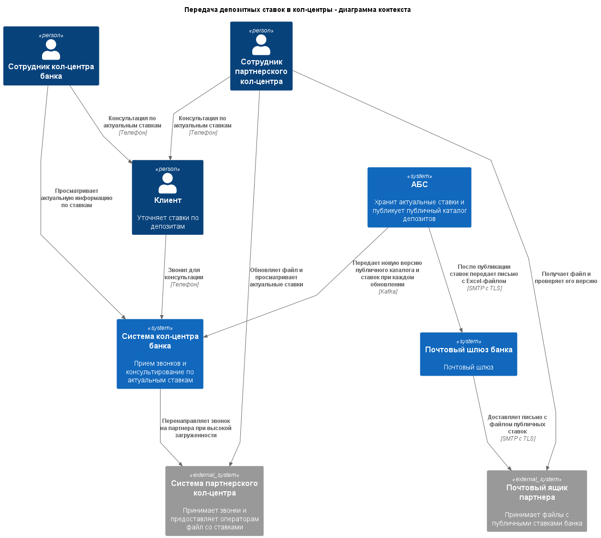
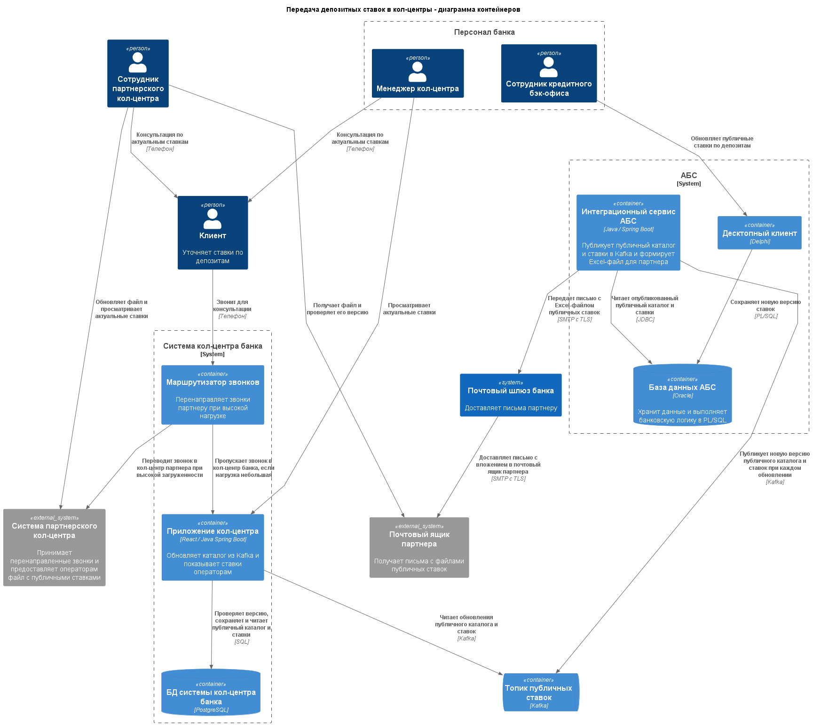
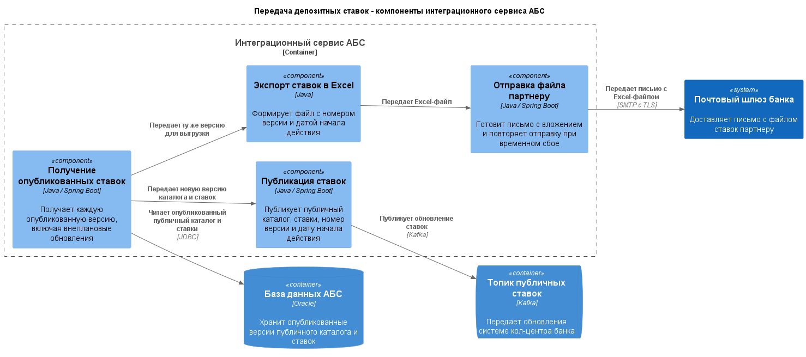

### **Название задачи: Передача актуальных депозитных ставок в кол-центр банка и партнерский кол-центр** 
### **Автор: Федоров Д.А.**
### **Дата: 24.11.2026**
### **Функциональные требования**

|**№**|**Действующие лица или системы**|**Use Case**|**Описание**|
| :-: | :- | :- | :- |
| UC1 | Клиент, сотрудник кол-центра банка, система кол-центра банка | Консультация по актуальным ставкам депозитов | 1. Клиент звонит в кол-центр банка и спрашивает о ставках по депозитам. 2. Сотрудник открывает список депозитов с актуальными ставками в системе кол-центра. 3. Сотрудник сообщает клиенту актуальные ставки по интересующим его депозитам. |
|UC2| Клиент, сотрудник партнерского кол-центра, система кол-центра банка, система партнерского кол-центра| Консультация по ставкам через кол-центр партнера|1. Клиент звонит в кол-центр банка 2. При высокой нагрузке маршрутизатор направляет звонок в кол-центр партнера 3. Отвечает сотрудник партнера, клиент запрашивает актуальную информацию 4. Сотрудник партнерского кол-центра открывает файл с актуальными ставками по депозитам и сообщает информацию клиенту|
| UC3 | АБС, интеграционный сервис АБС, почтовый шлюз, сотрудник партнерского кол-центра | Автоматическая передача ставок партнерскому кол-центру | **Предусловие:** в АБС опубликована новая версия публичных ставок по депозитам. 1. Интеграционный сервис формирует Excel-файл с публичными ставками, номером версии и датой начала действия. 2. Сервис отправляет файл через почтовый шлюз на согласованный адрес партнера. 3. Сотрудник партнерского кол-центра проверяет версию файла и делает ее доступной операторам для консультаций по UC2. |
| UC4 | АБС, система кол-центра банка | Получение актуальных ставок системой кол-центра банка | 1. После публикации новой версии интеграционный сервис АБС передает публичный каталог и ставки через Kafka. 2. Приложение кол-центра проверяет версию и сохраняет обновление в PostgreSQL. 3. Операторы видят действующие ставки в интерфейсе для консультаций по UC1. |
### **Нефункциональные требования**

|**№**|**Требование**|
| :-: | :- |
|1|В системе кол-центра банка и в файле для партнера указываются версия ставок и дата начала их действия. Повторная доставка старого файла не должна заменять более новую версию.|
|2|При временной ошибке выгрузки или отправки файла система повторяет попытку. Если обновление не выполнено в согласованный срок, сопровождение получает уведомление. Оператор должен видеть, что актуальность доступной версии не подтверждена.|
|3|Сопровождение может определить, какая версия сформирована, когда ее отправили и возникла ли ошибка. Для партнерского кол-центра отдельно согласуется способ подтверждения, что операторы получили доступ к новой версии.|
| 4 | В оба кол-центра передаются только публичный каталог и ставки. Почтовый шлюз отправляет вложения на согласованный адрес партнера по защищенному каналу. |

### **Решение**

Диаграмма контекста C4 показывает консультации, перенаправление звонков и оба маршрута передачи ставок.

[Исходник PlantUML](diagrams/c4_context_2.puml)

Диаграмма контейнеров C4 показывает АБС, платформу кол-центра банка, Kafka, PostgreSQL и почтовую интеграцию.

[Исходник PlantUML](diagrams/c4_container_2.puml)

Диаграмма компонентов C4 раскрывает четыре функции интеграционного сервиса АБС. Он получает опубликованную версию ставок, публикует ее в Kafka, формирует Excel-файл и отправляет письмо.

[Исходник PlantUML](diagrams/c4_abs_components.puml)

**Обновление ставок.** АБС остается источником истины. Интеграционный сервис на Java / Spring Boot использует опубликованную версию публичного каталога из Oracle для обоих маршрутов. Обработка запускается при публикации каждой версии, включая внеплановые изменения.

**Кол-центр банка.** Интеграционный сервис публикует версию, дату начала действия и публичные ставки в отдельный топик Kafka. Приложение кол-центра проверяет версию и сохраняет каталог в существующей PostgreSQL. Показы при консультациях обслуживаются из локальной копии, поэтому рост числа звонков не увеличивает число запросов к Oracle. При высокой нагрузке маршрутизатор кол-центра направляет звонки партнеру. Критерий переключения согласуется с кол-центром банка и партнером.

**Партнерский кол-центр.** Интеграционный сервис формирует Excel-файл с той же версией ставок и датой начала действия. Почтовый шлюз доставляет вложение в ящик партнера. Сотрудник партнера проверяет версию и обновляет файл в своей системе. Excel и SMTP с TLS выбраны для MVP. Поддержку формата, адрес получателя и параметры защищенной доставки нужно подтвердить с партнером и администраторами почты.

**Контроль доставки.** Сервис фиксирует версию и результат каждой попытки публикации и отправки, повторяет временные ошибки и уведомляет сопровождение при превышении согласованного срока. В кол-центре банка запоздавшая версия не заменяет новую. Операторы видят версию и дату ее действия. Для партнера проверка версии выполняется перед ручным обновлением файла, а способ подтверждения доступности новой версии согласуется отдельно.

### **Альтернативы**

1. **Запрос ставок из кол-центра банка по HTTPS.** Позволяет переиспользовать интерфейс публичного каталога из Task3. Периодический опрос добавляет задержку, а запросы при каждой консультации создают нагрузку на АБС. Kafka доставляет изменения после публикации, а PostgreSQL обслуживает чтение операторов.
2. **Ручная выгрузка и отправка файла партнеру.** Требует меньше изменений в АБС, но своевременность отправки зависит от сотрудника, особенно при внеплановом обновлении. Для MVP выбрана автоматическая отправка.

### **Недостатки, ограничения, риски**

| Риск или ограничение | Последствие и меры |
| --- | --- |
| Задержка обработки Kafka | Оператор банка временно видит предыдущую версию. Показываем ее дату и отмечаем неподтвержденную актуальность при превышении согласованного срока. |
| Задержка доставки письма и ручного обновления | Успешная отправка письма еще не подтверждает доступность файла у операторов. Согласуем предельную задержку и порядок подтверждения с партнером. |
| Повторная или несвоевременная доставка | Запоздавшая версия может затереть актуальную. Приложение банка сравнивает версии автоматически, сотрудник партнера проверяет версию перед заменой файла. |
| Недоступность партнера при высокой нагрузке | Перенаправление может увеличить время ожидания. Условия переключения и действия при недоступности партнера согласуются до запуска кампании. |
